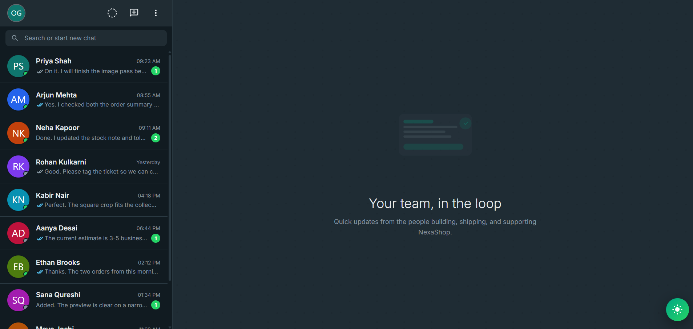

# 💬 ChatApp Pro — Real-Time Chat Application UI

A modern, responsive, and interactive chat application UI built using **HTML5, CSS3, and JavaScript**. ChatApp Pro delivers a WhatsApp-inspired messaging experience with a clean interface, interactive conversations, contact management, emoji support, and light and dark themes.

## 📸 Project Preview



## ✨ Features

- 💬 **Interactive Messaging UI** — Send and display messages in an intuitive chat interface.
- 👥 **Contact Management** — Browse contacts, view conversations, and check availability indicators.
- 🔍 **Contact Search** — Find contacts using the built-in search functionality.
- 🌙 **Dark & Light Mode** — Switch themes for a personalized viewing experience.
- 😊 **Emoji Picker** — Choose emojis to make conversations more expressive.
- 📎 **File Attachment Interface** — Select files and display attachment previews.
- ✓ **Message Status Indicators** — View message delivery and read-status indicators.
- ⌨️ **Typing Indicator** — Display a typing animation within the conversation.
- 🗑️ **Message Actions** — Access contextual message actions, including copying and deleting messages.
- 💾 **Local Storage** — Preserve supported message data and theme preferences across browser sessions.
- 📱 **Responsive Design** — Adapt the interface for desktop and mobile screen sizes.
- 🎨 **Modern UI Design** — Enjoy smooth animations, polished components, and a familiar messaging layout.
- ⚡ **Interactive Components** — Explore profile panels, image previews, emoji controls, and additional interface elements.

## 🛠️ Technologies Used

- **HTML5** — Application structure and semantic markup.
- **CSS3** — Styling, responsive layouts, animations, and theme customization.
- **JavaScript** — Interactive components, messaging behavior, event handling, and local storage.
- **Google Fonts** — Inter typography.

## 📂 Project Structure

```text
real-time-chat-application-ui/
│
├── index.html
├── README.md
│
├── css/
│   └── style.css
│
├── js/
│   └── script.js
│
└── images/
    └──preview.png
    └──Omkar.jpeg

```

## 🚀 Getting Started

Follow these steps to run the project locally.

### 1. Clone the Repository

```bash
git clone https://github.com/ghareomkarr88/real-time-chat-application-ui.git
```

Replace `ghareomkarr88` with your GitHub username.

### 2. Navigate to the Project Folder

```bash
cd real-time-chat-application-ui
```

### 3. Run the Application

Open `index.html` in your web browser.

Alternatively, use the **Live Server** extension in Visual Studio Code for a convenient local development experience.

No package installation or build process is required for the current front-end implementation.

## 🧪 How to Explore the Project

1. Open the application in your browser.
2. Select a contact to explore the conversation interface.
3. Try sending messages and interacting with the available chat controls.
4. Search for contacts using the search field.
5. Switch between light and dark themes.
6. Explore the emoji picker and file attachment interface.
7. Refresh the page to test the supported local storage functionality.
8. Resize the browser window to explore the responsive layout.

## 🌐 Live Demo

**Live Preview:** https://ghareomkarr88.github.io/real-time-chat-application-ui/

## ⚠️ Project Scope

This repository demonstrates a front-end chat application interface built with HTML, CSS, and JavaScript.

The current implementation uses sample conversations and browser-side functionality. It does not include a backend messaging server or real-time communication infrastructure for exchanging messages between independent users.

Features such as persistent cross-device messaging, authentication, and real-time synchronization would require additional backend services.

## 🎯 Project Goals

- Practice modern front-end development.
- Build an interactive messaging interface.
- Improve responsive web design skills.
- Explore DOM manipulation and browser local storage.
- Create a polished project for a developer portfolio.

## 👨‍💻 Author

**Omkar R. Ghare**

Front-End Web Developer

## 📄 License & Copyright

© 2026 Omkar R. Ghare. All rights reserved.

This project is presented for portfolio and educational purposes. Please contact the author for permission before redistributing or commercially reusing the project.

---

⭐ **If you like this project, consider giving the repository a star!**
